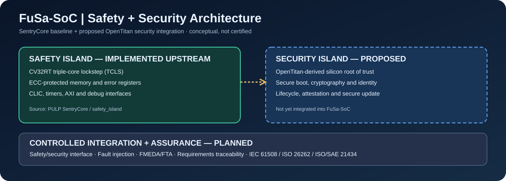
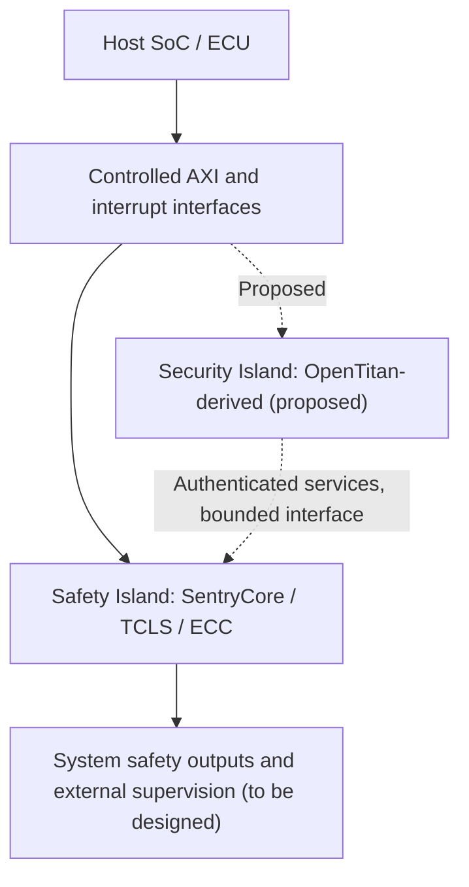

<div align="center">

# FuSa-SoC
### Open-source functional safety silicon, with a roadmap to integrated cybersecurity

**Safety-first RISC-V subsystem · Reproducible verification · Open assurance evidence**

[Architecture](#architecture) · [Getting Started](#getting-started) · [Safety & Security](#safety--security) · [Roadmap](#roadmap) · [Upstream](#upstream-and-attribution)



</div>

> [!IMPORTANT]
> **Development-stage research project.** FuSa-SoC is **not certified** to IEC 61508, ISO 26262, or ISO/SAE 21434. No SIL, ASIL, diagnostic-coverage, or automotive production-readiness claim is made. The OpenTitan integration shown above is **proposed**, not implemented.

## Vision

FuSa-SoC aims to make safety-oriented semiconductor design more accessible, inspectable, and reproducible. We are starting with a proven open RTL research foundation, preserving its attribution, and building toward an independently verifiable safety-and-security subsystem for automotive, robotics, and industrial applications.

**Our objective:** reusable RTL, firmware, test infrastructure, safety analyses, and traceable evidence that developers can evaluate and adapt to their own system-level safety requirements. Evidence is application- and configuration-dependent; this project does not replace independent assessment.

## Architecture

The current implementation is a fork of the [PULP Safety Island / SentryCore](https://github.com/pulp-platform/safety_island), originally developed for the [Carfield SoC](https://github.com/pulp-platform/carfield) by ETH Zurich and the University of Bologna.

| Area | Current baseline | FuSa-SoC direction |
| --- | --- | --- |
| Compute | CV32RT-based triple-core lockstep, configurable TCLS | Characterize fault detection, timing, and common-cause risks |
| Memory | Configurable memory banks and ECC/error reporting | Fault injection and diagnostic evidence |
| Integration | AXI input/output, JTAG, interrupt and timer interfaces | Document integration assumptions and safety interfaces |
| Software | PULP runtime and FreeRTOS examples | Safety services, fault response and verification |
| Cybersecurity | No integrated OpenTitan security island established | Evaluate OpenTitan root-of-trust integration |
| Assurance | Upstream tests and research artifacts | IEC 61508 / ISO 26262 evidence, plus ISO/SAE 21434 security engineering |

### Existing hardware block diagram


### Proposed system boundary



**Safety principle:** security controls must not block a required safety response. Safe-state actuation, external supervision, diagnostic independence, and freedom from interference must be established for each target application.

## Safety & Security

| Framework | Intended engineering work | Current status |
| --- | --- | --- |
| IEC 61508 | Safety lifecycle, requirements, verification, systematic and random hardware integrity | Planned |
| ISO 26262 | Item definition, HARA, safety concepts, hardware/software analyses and safety case | Planned |
| ISO/SAE 21434 | Cybersecurity item definition, TARA, cybersecurity requirements and validation | Planned |
| Safety/security co-engineering | Threat-to-hazard relationships, shared resources, update controls, fault escalation | Planned |

We will publish evidence **with its assumptions, configurations, limitations, and verification status**. Neither lockstep nor ECC alone establishes a SIL/ASIL capability.

## Getting Started

This fork currently retains the upstream build flow. Its simulator instructions reference **QuestaSim**, and the software tests require a compatible PULP RISC-V toolchain. Commands below are inherited from upstream and **have not yet been validated in FuSa-SoC CI**.

```bash
git clone https://github.com/TomcoGame/FuSa-SoC.git
cd FuSa-SoC
make pulp-runtime
make pulp-freertos
source env/env.sh
make checkout
make build SIM_TOP=tb_safety_island_preloaded
```

For JTAG mode:

```bash
make build SIM_TOP=tb_safety_island_jtag
```

Existing software tests live under `sw/tests/`, including ECC, bus error, timer, CLIC, FPU, AXI and FreeRTOS examples. Consult upstream README history for additional environment details.

## Roadmap

- [x] Establish public fork of PULP Safety Island
- [x] Publish FuSa-SoC identity and conceptual architecture
- [ ] Reproduce dependency checkout and RTL simulation in a documented environment
- [ ] Add a verified, repeatable CI pipeline with clearly scoped checks
- [ ] Baseline requirements, assumptions, configuration and safety manual outline
- [ ] Implement and measure ECC / TCLS fault-injection campaigns
- [ ] Develop preliminary FMEA / FMEDA / FTA and diagnostic claims
- [ ] Define independent safe-state and external supervision interfaces
- [ ] Perform OpenTitan integration trade study and license review
- [ ] Prototype security-domain integration and safety/security interference tests
- [ ] Produce a reviewable assurance package for a specific reference use case

## Repository map

| Path | Purpose |
| --- | --- |
| `rtl/` | Safety-island RTL and testbench sources |
| `sw/tests/` | Existing runtime and FreeRTOS software tests |
| `sim/` | Simulation build infrastructure |
| `boot/` | Boot support |
| `doc/` | Upstream architecture diagram |
| `docs/assets/` | FuSa-SoC diagrams and visual documentation |
| `Bender.yml` / `Bender.lock` | RTL dependency definition and resolution |
| `.github/workflows/` | Existing upstream-derived CI workflows |

## Upstream and attribution

FuSa-SoC is derived from [pulp-platform/safety_island](https://github.com/pulp-platform/safety_island), a joint PULP project of **ETH Zurich and the University of Bologna**. The original work was presented as **SentryCore: A RISC-V Co-Processor System for Safe, Real-Time Control Applications** at RISC-V Summit Europe 2024.

**Preserved upstream technical work:** TCLS processor subsystem, RTL, simulation environment, software tests, dependencies, and the original architecture diagram. FuSa-SoC's branding and roadmap do not imply authorship of the upstream implementation or endorsement by its authors.

## License and contribution status

Per the upstream README, hardware and tool scripts are generally under **Solderpad Hardware License 0.51**, and software generally under **Apache 2.0**, unless individual file headers specify otherwise. Review `LICENSE.md`, source headers, and all transitive dependencies before redistribution or commercial integration.

Contributions are welcome in principle; a formal contribution policy, coding standard, and review workflow are planned. Please open an issue describing the proposed change and its safety implications before submitting substantial RTL changes.

---

<div align="center"><sub>FuSa-SoC is an open research and engineering effort. Safety claims require evidence, configuration control, and application-specific assessment.</sub></div>
