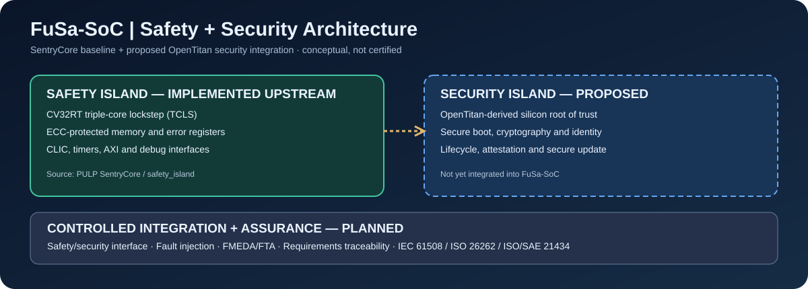

# FuSa-SoC Architecture

## Status and boundaries

FuSa-SoC currently contains the upstream PULP Safety Island. The security island, independent external safety outputs, and automotive assurance package are **planned**, not implemented.

## Existing SentryCore baseline

The upstream safety island provides configurable triple-core lockstep (TCLS) around CV32RT, ECC-related memory/error handling, AXI integration, CLIC, timer, JTAG and software test examples. The top-level RTL is `rtl/safety_island_top.sv`, with core wrapper in `rtl/safety_core_wrap.sv`.

## Proposed domains

1. **Safety domain:** fault detection, deterministic monitoring, error escalation, and bounded safety response. Existing TCLS/ECC features require validation under a defined fault model.
2. **Security domain:** evaluate OpenTitan-derived root-of-trust functions for secure boot, identity, keys, and update authorization. This is not yet integrated.
3. **Integration domain:** AXI, clocks, resets, power, interrupts, and communication interfaces; must analyze freedom from interference and common-cause failures.
4. **External safety path:** system-specific independent supervisor and safe-state actuation, not currently provided by this IP.

## Key architectural questions

- Which target application and safety function establish the fault-tolerant time interval?
- Can security-originated failures block safety response or introduce common-cause faults?
- How are lockstep discrepancies, ECC errors, bus faults and watchdog events latched and escalated?
- What independent external mechanism guarantees the required safe state?
- Which clock, reset, power and debug dependencies can defeat diagnostic independence?

## Design-control policy

Keep upstream RTL unchanged until reproducible builds and tests are established. Record each modified IP version, dependency lock, safety requirement, verification result and review decision. Do not describe a design as SIL/ASIL compliant without a supported application-specific safety case.
